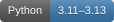

# Healthcare Document Extraction and Intake Analytics




A Streamlit based app that converts scanned **synthetic** intake and prior-authorization forms into seven structured fields: member ID, provider, service date, procedure code, diagnosis code, requested service, and decision status. Review the scan beside OCR evidence, correct fields, and export CSV or JSON with provenance.

**Synthetic data only. Not a clinical tool or real-world healthcare validation. Do not upload patient information.** No paid APIs, external OCR services, or downloaded language models are used.

## Run locally

Use Python 3.11–3.13 and install the Tesseract executable with English language data (macOS: `brew install tesseract`; Debian/Ubuntu: `sudo apt install tesseract-ocr tesseract-ocr-eng`). Then, from the project directory:

```bash
python3 -m venv .venv
source .venv/bin/activate
python -m pip install -e '.[dev]'
tesseract --version
streamlit run app.py
```

Open <http://127.0.0.1:8501>. The 240 labeled scans and a scanned PDF upload fixture are bundled in `data/`. The measured environment used Python 3.13.7 and Tesseract 5.5.2; direct Python dependencies are pinned in `pyproject.toml`.

For Streamlit Community Cloud, use main file path `app.py`, select Python **3.13**, and leave Secrets empty. Root-level `requirements.txt` lists the same Python dependencies as `pyproject.toml`; `packages.txt` installs Tesseract and its English language data on the server.

## Demo walkthrough

1. Keep **Bundled sample**, layout **authorization**, sample **authorization-001**. Inspect its scan and expand **OCR text and processing stages** to compare raw text, normalized text, tokens, and spaCy entities.
2. Review the evidence table. On the measured environment, Tesseract reads the member ID as `SYNO2000001`; correct it to `SYN02000001` using the visible scan. Save the reviewed record, then download JSON or CSV. The original OCR value remains in the audit.
3. Select sample **authorization-000** to see a deliberate blank member ID and conflicting statuses. Missing fields stay empty; conflicts have no selected value. Unresolved records can be exported with `review_needed=true`.
4. Choose **Upload synthetic document**, confirm synthetic content, and upload `data/synthetic-demo.pdf` (also available from the sidebar download). Inspect, correct, save, and export it through the same flow.
5. Expand **Synthetic dataset and held-out evaluation** to inspect split counts and measured results. Downloads always represent the last saved review; save again after editing.

## Architecture and lifecycle

The scoped question is whether a transparent local baseline can recover fields from controlled scans and expose uncertainty for human review. `scripts/generate_data.py` creates transcripts and character-offset entity labels before rendering images. It generates 60 documents for each of four layouts, with reordered fields, different headings, spacing, borders, mild rotation/blur, deliberate blanks, and conflicting statuses. All documents visibly say SYNTHETIC. There are no real patient records.

The fixed seed is **20261024**. The `intake`, `authorization`, and `referral` templates form the **180-document development set**; the entire `review` template is the **60-document evaluation set**. This is a template holdout, not a random document split. The schema, label aliases, and synthetic entity vocabulary were defined up front. Development errors were inspected before running the held-out evaluation; no rules were changed to optimize its results.

`intake/pipeline.py` loads images with Pillow or rasterizes PDFs with PyMuPDF, applies grayscale/autocontrast, and runs Tesseract English OCR (`--psm 6`, PDF rendering at 180 DPI). Unicode/whitespace normalization preserves page boundaries. A blank English spaCy pipeline provides tokenization and **rule-based NER via EntityRuler**, supplemented by field-label and date rules.

Candidates retain verbatim normalized-OCR text, character offsets, page number, source line, and extraction method. Format/date checks flag missing, invalid, and conflicting values; they do not infer missing values or verify medical correctness. `app.py` overlays explicit reviewer corrections without changing the original extraction. `intake/export.py` preserves provenance and escapes spreadsheet formula prefixes in CSV. Uploads and cached OCR stay in process memory; restarting clears them.

## Reproduce and evaluate

```bash
python scripts/generate_data.py
python scripts/evaluate.py --split development
python scripts/evaluate.py
python -m pytest -q
```

Generation defaults to 240 scans. `--seed`, `--per-layout`, `--out`, and `--font /path/to/font.ttf` are available. It uses local Arial or DejaVu Sans; the manifest records the font checksum, per-image checksums, degradation parameters, split, transcript, and entity offsets. Identical image regeneration requires the same font and Pillow version. Tesseract/platform differences can change OCR results; evaluate the bundled images to reproduce this benchmark without font substitution.

Evaluation writes ignored `outputs/{split}-summary.json` and `outputs/{split}-details.json`, including OCR text, individual errors, dataset/pipeline checksums, and software versions. `data/evaluation-summary.json` is the retained measured snapshot used by the app; reruns do not silently replace it.

Measured on **60 held-out synthetic review forms** with **419 gold entities**:

| Metric | Actual result |
| --- | ---: |
| OCR word error rate | **0.0411%** (1 edit / 2,433 reference words) |
| Entity micro precision / recall / F1 | **1.0000 / 1.0000 / 1.0000** |
| Missing-field rate | **1.19%** (5 / 420 field slots; all deliberately blank) |
| Unselected fields, including conflicts | **2.14%** (9 / 420) |
| Extracted values with traceable evidence | **100%** (419 / 419) |

| Field | Precision | Recall | F1 | Gold entities |
| --- | ---: | ---: | ---: | ---: |
| Member ID | 1.0000 | 1.0000 | 1.0000 | 59 |
| Provider name | 1.0000 | 1.0000 | 1.0000 | 59 |
| Service date | 1.0000 | 1.0000 | 1.0000 | 59 |
| Procedure code | 1.0000 | 1.0000 | 1.0000 | 59 |
| Diagnosis code | 1.0000 | 1.0000 | 1.0000 | 59 |
| Requested service | 1.0000 | 1.0000 | 1.0000 | 60 |
| Decision status | 1.0000 | 1.0000 | 1.0000 | 64 |

WER is aggregate word-level Levenshtein distance after Unicode/whitespace cleanup, retaining case and punctuation. Entity scoring uses exact `(document, field, value)` matches after case/whitespace normalization, deduplicates repeated identical values, and includes both values in conflicts. It measures end-to-end field extraction, not token accuracy or span-boundary NER accuracy. Scikit-learn computes precision/recall/F1 from the gold/predicted entity union. Missing-field rate counts slots with no candidate; unselected rate additionally counts conflicts. Evidence coverage checks substring offsets and source quotes, not semantic correctness.

For context, the **180 development forms** produced **1.5037% WER** and **0.9121 micro F1**; member-ID F1 was **0.3775**, largely from `O`/`0` OCR confusion.

## Validation and limitations

All **seven tests pass**, covering conflicts, missing fields, correction separation, evidence offsets/page numbers, date validation, image/PDF loading limits, metric errors, CSV escaping, and review-state isolation between samples. A second seeded generation reproduced all 240 image checksums and the manifest exactly. Browser verification exercised a bundled scan and an uploaded scanned PDF, corrected their member IDs, saved reviews, and downloaded JSON/CSV; the uploaded JSON retained the original OCR value and the separate correction.

The benchmark is intentionally narrow: printed English, a small shared vocabulary, predefined label aliases, single-column forms, and mild degradation. The held-out layout changes rendering and ordering; it does not hold out providers, services, or label vocabulary. Perfect held-out entity scores do not imply generalization to unfamiliar forms, handwriting, severe scan defects, or clinical documents. Procedures and diagnoses are independently sampled and not medically validated. Validation checks syntax rather than code-system validity, coverage eligibility, clinical consistency, or true patient identity. Evidence can faithfully quote an incorrect OCR value. There are no OCR confidence calibration, scan-coordinate overlays, production security controls, or longitudinal analytics. Upload limits are 20 MB, five PDF pages, and 20 megapixels per rendered page/image; multi-frame images and encrypted PDFs are rejected.
